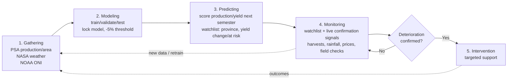
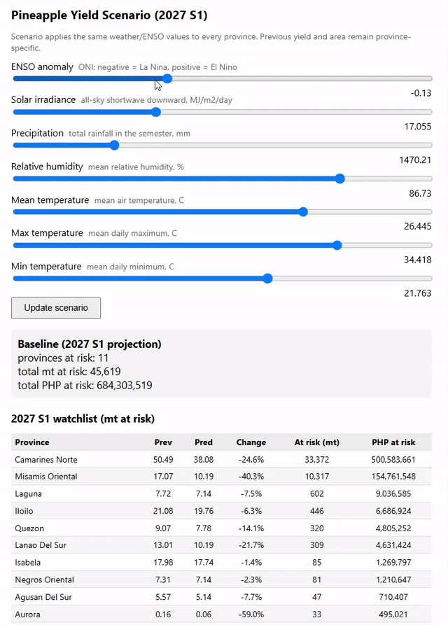

# 🍍 Pineapple Yield Prediction

Province-semester yield (`mt/ha`) early-warning model for the Philippines.

Users: regional planning offices.

## Problem

Pineapple production in the Philippines varies at the province-semester level.
The objective is to develop an early-warning system so that government
intervention can be performed in a timely manner, ultimately benefiting farmers.

## Solution

A model that generates expectations about future yield (`mt/ha`) to guide
decision-making by regional planning offices. It flags a likely low-yield
semester (a drop of at least 5%) about 12 months ahead, using lagged weather,
ENSO, and yield momentum.

Models compared: `LinearRegression`, `DecisionTree`, `RandomForest`, `XGBoost`.

Primary evaluation: RMSE on `log1p(yield)`. For the warning decision, precision,
recall, and F2 (recall-weighted) are reported. F2 is the selection metric because
a missed drop is more costly than a false alarm.

### Simulated use case (2027 S1)



## Data

Raw snapshots and provenance are in `data/raw/` and `provenance/`; normalized
tables used for analysis are in `data/normalized/`. The data collection pipeline
was built using AI, as this is not the main focus of the course.

| Source | Content |
|---|---|
| PSA OpenSTAT | production, area, farmgate prices |
| NASA POWER | monthly weather by province |
| NOAA CPC | Oceanic Nino Index (ONI), the ENSO indicator used |
| PSGC + geoBoundaries | province codes and centroids (reference for NASA weather) |

PSGC and geoBoundaries are reference layers used to build the province-level
weather features; they are not model inputs.

ENSO = El Nino-Southern Oscillation, the climate pattern; ONI = Oceanic Nino
Index, the specific sea-surface temperature anomaly used to measure it.

Cleaned dataset: 28 provinces, 2010-2026, 658 province-semester rows.

## Data pipeline (optional - refresh only)

The normalized data is already committed, so reviewers can skip this. To refresh
from PSA/NASA/NOAA or check integrity:

```bash
pip install -r requirements.txt   # or: uv sync
py -m src.run all                 # network; rebuilds data/normalized
py -m src.verify                  # offline integrity check
```

## Quality-of-life scripts

| Script | What it does | Approx. time |
|---|---|---|
| `run_docker.bat` | Build and run the Docker image | first build 2-3 min; cached build 10-30 s |
| `run_server_api.bat` | Start the FastAPI service on port 9696 | a few seconds |
| `run_notebook.bat` | Open JupyterLab (`run_notebook.bat exec` runs top-to-bottom) | open: seconds; exec: 1-2 min |
| `run_training.bat` | Train and save `model/pineapple_yield_model.joblib` | ~10 s |
| `run_verification.bat` | PASS/FAIL check against `samples/sample_request.json` | ~5 s |

### Build-up from scratch

```
git clone <repo-url>
        |
        v
cd ml-cohort-2026/pineapple_yield_prediction
        |
        v
start Docker Desktop
        |
        v
double-click run_docker.bat
        |
        v
open http://localhost:9696/   (the bat also opens it)
```

`run_docker.bat` and `run_server_api.bat` are alternatives: Docker starts the
service inside the container, while `run_server_api.bat` starts it locally with
uv. Use one at a time, since both bind port 9696.

Optional checks:

```
run_notebook.bat      -> notebook.ipynb (data prep, EDA, models, demos)
run_training.bat      -> retrain and replace model/pineapple_yield_model.joblib
run_verification.bat  -> PASS/FAIL check of sample_request.json
```

## Notebook (`notebook.ipynb`)

Data prep, EDA, feature engineering, model selection/tuning, and the
early-warning and cost-of-late-intervention demos.

Features (lag 2 = one year cycle):

- `oni_anom_prev2` — ENSO anomaly two semesters ago; negative = La Nina, positive = El Nino
- `allsky_sfc_sw_dwn_prev2` — all-sky solar irradiance two semesters ago, MJ/m2/day
- `prectotcorr_prev2` — total rainfall in the semester two semesters ago, mm
- `rh2m_prev2` — mean relative humidity two semesters ago, %
- `t2m_prev2` — mean air temperature two semesters ago, C
- `t2m_max_prev2` — mean daily maximum temperature two semesters ago, C
- `t2m_min_prev2` — mean daily minimum temperature two semesters ago, C
- `yield_prev2` — yield in the same semester last year, mt/ha

Full definitions, units, and data quirks: [docs/data_dictionary.md](docs/data_dictionary.md).
Pipeline details: [docs/pipeline.md](docs/pipeline.md).

Data split:

- train <= 2022 (513)
- validate 2023-24 (80)
- test >= 2025 (65)

| Model | Val RMSE | Val Precision | Val Recall | Val F2 | Test RMSE |
|---|---|---|---|---|---|
| Seasonal persistence (`yield_prev2`, same semester last year) | 0.390 | 0.00 | 0.00 | 0.00 | 0.379 |
| LinearRegression | 0.500 | 0.31 | 0.53 | 0.47 | - |
| DecisionTree (depth 6) | 0.385 | 0.58 | 0.47 | 0.49 | 0.424 (3.51 mt/ha) |
| RandomForest (depth 5) | 0.389 | 0.77 | 0.33 | 0.38 | - |
| XGBoost (depth 4) | 0.351 | 0.55 | 0.37 | 0.39 | 0.399 (4.18 mt/ha) |

Alert metrics are at the -5% threshold on validation. 

**Final model: DecisionTree.**

XGBoost had the best RMSE, but DecisionTree had the best alert
F2 (0.49) and is the model used for the warning decision.

`yield_prev2` dominates feature importance (~0.97 for the tree); lag-2 weather
adds little.

Early-warning demo (DecisionTree, -5% threshold, test):

- precision 0.38, recall 0.26, F2 0.28
- 16 of 65 provinces flagged; 6 confirmed declines
- ~91,925 mt (~PHP 1.38 B) at risk at assumed PHP 15/kg
- 2027 S1: watchlist flags 6 of 22 provinces

## Train the model

```bash
python train.py        # or double-click run_training.bat
```

Writes `model/pineapple_yield_model.joblib`. Prints KPIs (rows, split sizes,
DecisionTree vs baseline RMSE).

## Run the service

```bash
python predict.py      # or double-click run_server_api.bat
```

- Health: http://localhost:9696/health
- Browser form: http://localhost:9696/ (sliders + scenario watchlist)
- Swagger UI: http://localhost:9696/docs
- Sample request: `samples/sample_request.json` -> `samples/sample_response.json`

The browser form applies the selected weather/ENSO values to all provinces;
previous yield and area remain province-specific. 

Double-click `run_verification.bat` for a PASS/FAIL check (no server needed).

### Demo



[Full-quality video](docs/pineapple-yield-scenario.mp4)

## Docker

```bash
docker build -t pineapple-yield .
docker run -it -p 9696:9696 pineapple-yield
```

Or double-click `run_docker.bat`. It prints the build time at the end. The first
build takes a few minutes (base image + dependencies); later builds use the cache
and finish in seconds. The image installs only the serving dependencies
(`requirements-serve.txt`), not the notebook stack.

## Limitations

- Test precision/recall (0.38 / 0.26) are lower than validation (0.58 / 0.47);
  the test set has only 65 rows.
- The dataset is small after cleaning, and the model relies heavily on
  `yield_prev2`; weather features add little.
- Seasonal persistence has better log RMSE (0.379 vs 0.424); the mt/ha difference
  is negligible (3.51 vs 3.58) and is not the basis for selection. The tree was
  chosen for alert F2/recall, not RMSE.
- Yield is the prediction target, but province impact is measured by production
  (`area x yield`), not yield alone.
- 190 of 658 rows (28.9%) have yield < 5 mt/ha, and 47 are below 1 mt/ha. These
  likely mix real low-yield areas with PSA reporting inconsistencies. They are
  retained because removing them would leave 468 rows (below the 500-row
  minimum) and bias the model toward high-yield provinces. The `area_ha >= 100`
  filter removes tiny/partial reporting units, not low-yield provinces.
- The 2027 S1 projection covers only the 22 provinces with 2026 S1 data.
- The web service retrains the DecisionTree on all 658 rows; the notebook test
  and projection use train+val (593 rows), so predictions can differ slightly.
- No cloud deployment.

## Next steps

1. **Expand the dataset** — more province-semester history, especially for
   low-yield provinces, and a larger test period.
2. **Add features** — irrigation, fertilizer use, disease/pest pressure,
   planting dates, and variety.
3. **Improve validation** — time-series cross-validation and per-province
   precision/recall.
4. **Tune the alert threshold** — compare -5%/-10% by province and by cost of
   missed vs false alarms.
5. **Deploy to the cloud** (optional) — the Docker image is ready to host.

## Structure

```
data/
docs/
provenance/
src/
model/
samples/
tools/
README.md
notebook.ipynb
train.py
predict.py
requirements.txt
requirements-serve.txt
Dockerfile
run_notebook.bat
run_training.bat
run_verification.bat
run_server_api.bat
run_docker.bat
```
